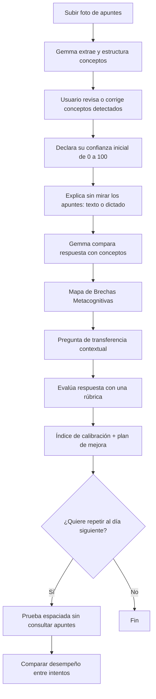

# Neuro-Feynman

> **Detector de ilusión de competencia y entrenador de recuperación activa asistido por Gemma 4.**
>
> **Propuesta de valor:** «Neuro-Feynman no te pregunta cuánto estudiaste. Te demuestra cuánto de lo que estudiaste realmente puedes explicar, recordar y aplicar».

**Contexto:** Propuesta para un hackatón de IA y neurotecnología (Hacktoberfest × NeuroTech UMSA 2026).  
**Estado:** Concepto y especificación de MVP.  
**Público objetivo:** Estudiantes de colegio y universidad que desean comprobar su comprensión antes de un examen.

---

## 1. Problema

Muchos estudiantes confunden **familiaridad** con **dominio**: releer o reconocer información puede producir la sensación de saberla, aunque luego resulte difícil recuperarla o aplicarla sin mirar los apuntes.

Esta diferencia se relaciona con la **ilusión de competencia** y la **calibración metacognitiva**: la distancia entre la confianza subjetiva y el desempeño demostrado en una tarea.

**Neuro-Feynman convierte esta diferencia en algo visible y accionable** mediante una evaluación breve que combina apuntes, autoexplicación y preguntas de aplicación.

### Fundamentos cognitivos

| Concepto | Aplicación |
|---|---|
| **Metacognición** | Comparar lo que el estudiante cree saber con lo que demuestra. |
| **Recuperación activa (active recall)** | Recordar y explicar el tema sin mirar los apuntes. |
| **Autoexplicación** | Explicar relaciones, causas y ejemplos con palabras propias. |
| **Preguntas de transferencia** | Aplicar el concepto a una situación nueva. |
| **Dificultades deseables** | Introducir un desafío razonable que fomente el esfuerzo de recuperación, sin volver la prueba engañosa o arbitraria. |
| **Práctica espaciada** | Ofrecer una segunda prueba al día siguiente para explorar la retención posterior. |

> **Precisión científica:** La aplicación **no mide sinapsis, hipocampo, corteza prefrontal ni consolidación neuronal**. Sus resultados son *indicadores del desempeño cognitivo observado*, no un diagnóstico neurológico. Evitar llamar al resultado «Diagnóstico Sináptico»; usar **Mapa de Brechas Metacognitivas**.

---

## 2. Solución

Una aplicación donde el estudiante:

1. **Carga una foto** de sus apuntes, pizarra o diapositiva.
2. **Declara su nivel de confianza** en el tema, de 0 a 100 %.
3. **Sin mirar el material, explica** lo que recuerda por escrito o mediante voz convertida a texto.
4. **Gemma 4 analiza la fuente y la explicación** para identificar conceptos abordados, relaciones demostradas y posibles omisiones.
5. **Visualiza un Mapa de Brechas Metacognitivas** con evidencias, observaciones y conceptos pendientes.
6. **Responde una pregunta de transferencia** diseñada para comprobar comprensión, no solo repetición literal.
7. **Recibe un índice de calibración** entre confianza inicial y desempeño evaluado.
8. **Opcionalmente vuelve al día siguiente** para comprobar cuánto puede recuperar sin revisar el contenido antes.

**Meta de UX:** El recorrido principal debe ser muy breve (objetivo de producto: unos 2 minutos para una primera evaluación sencilla); no garantizar ese tiempo para temas complejos ni imágenes extensas.

---

## 3. Función estrella: Índice de Ilusión de Competencia

### Pregunta de entrada

**«¿Qué tan preparado te sientes para responder preguntas de este tema?»**

El usuario selecciona un valor de **0 a 100 %** antes de recibir la evaluación.

### Cálculo ilustrativo

```text
Brecha de calibración (puntos porcentuales)
    = Confianza declarada (%) − Desempeño evaluado (%)
```

**Ejemplo:**

- Confianza declarada: **90 %**.
- Desempeño evaluado mediante rúbrica: **55 %**.
- Brecha: **+35 puntos** → posible **sobreestimación** del dominio del tema.

**Interpretación:**

- **Brecha positiva:** la confianza supera al desempeño observado.
- **Brecha cercana a cero:** confianza y desempeño están relativamente alineados.
- **Brecha negativa:** el desempeño observado supera la confianza declarada.

El número es un **indicador de calibración**, no un porcentaje de «conexiones cerebrales» ni una medida clínica de la ilusión de competencia.

### Visualización

Mostrar un módulo con:

- Barra: **«Lo que crees saber»** (confianza previa).
- Barra: **«Lo que demostraste»** (resultado de una rúbrica visible).
- Diferencia en **puntos porcentuales**.
- Una explicación en lenguaje cotidiano.
- Recomendación concreta: qué practicar primero.

> **Importante:** No afirmar que existe «ilusión de competencia» por un único intento aislado. Usar «posible sobreestimación», porque la puntuación depende de la calidad de la fuente, la selección de preguntas y la rúbrica. Umbrales visuales (p. ej., diferencia de 20 puntos) son reglas de producto preliminares, no cortes clínicamente validados.

### Rúbrica sugerida para el MVP (experimental)

| Dimensión | Peso inicial |
|---|---:|
| Conceptos clave recuperados correctamente | 40 % |
| Relaciones, causas y explicaciones conceptuales | 30 % |
| Pregunta nueva de aplicación / transferencia | 30 % |
| **Total** | **100 %** |

Los pesos pueden ajustarse por materia y dificultad. Deben mostrarse y registrarse para que el resultado sea auditable. Hasta completar la pregunta de transferencia, mostrar un **resultado provisional**; después, el **resultado final**.

---

## 4. Mapa de Brechas Metacognitivas

Gemma 4 contrasta el contenido extraído de la imagen con lo que el estudiante escribió o dictó.

### Estados

| Estado | Color de interfaz | Significado |
|---|---|---|
| **Demostrado** | Verde | Explicó correctamente el concepto con evidencia en su respuesta. |
| **Por verificar** | Amarillo | Reprodujo términos, su respuesta es ambigua o todavía falta comprobar comprensión. |
| **Omitido o incorrecto** | Rojo | No mencionó un concepto importante o lo explicó de forma incompatible con la fuente. |

Para cada elemento, mostrar:

- Nombre del concepto.
- Fragmento o referencia de la fuente que lo respalda.
- Evidencia textual de la respuesta del estudiante, si existe.
- Justificación corta de la evaluación.
- **Una pregunta correctiva o de transferencia** para los conceptos no demostrados.

**Regla crítica:** Una omisión no equivale automáticamente a desconocimiento. El mapa solo describe lo que **no se demostró en esta respuesta**. Del mismo modo, repetir una definición literalmente no demuestra ni descarta comprensión: el sistema debe verificarla con una pregunta adicional.

---

## 5. Flujo completo del usuario



### Pantallas mínimas

**Pantalla 1 — Fuente de verdad**
- Subir imagen con vista previa.
- Extraer temas / conceptos.
- Permitir editar conceptos si el modelo interpretó mal la letra o el contenido.

**Pantalla 2 — Predicción metacognitiva**
- Slider de confianza de 0 a 100 %.
- Mensaje: «Responde antes de ver tu resultado».

**Pantalla 3 — Recuperación activa**
- Área de texto y opción de micrófono.
- Instrucción: «Explícalo como si se lo enseñaras a un compañero, sin ver el apunte».
- Opción de temporizador orientativo.

**Pantalla 4 — Diagnóstico de brechas**
- Tarjetas verdes, amarillas y rojas.
- Evidencias recuperadas y faltantes.
- Puntaje provisional claramente identificado.

**Pantalla 5 — Pregunta de aplicación**
- Un desafío contextual, corto, que requiera razonamiento.
- Campo de respuesta.
- Corrección argumentada y oportunidad de volver a intentarlo.

**Pantalla 6 — Resultado**
- Confianza previa, desempeño final y brecha.
- Conceptos fuertes y conceptos para repasar.
- Recomendación de estudio específica.
- Opción: «Volver a evaluarme mañana».

---

## 6. Ejemplo de demostración: Redes de computadoras

**Tema fotografiado:** NAT y PAT.

**Confianza declarada:** 90 %.

**Explicación inicial del estudiante:**

> «NAT permite cambiar direcciones IP privadas por públicas para acceder a Internet».

**Análisis razonable del sistema:**

- **Demostrado (verde):** noción básica de traducción de direcciones.
- **Por verificar (amarillo):** cómo se distingue el tráfico de diferentes conexiones.
- **Omitido (rojo):** funcionamiento de PAT y uso de puertos, si ambos son conceptos fundamentales del material cargado.

**Pregunta de transferencia de Gemma:**

> «Tienes 30 computadoras y una sola dirección IP pública. ¿Cómo hace el router para distinguir a qué computadora corresponde cada respuesta que llega desde Internet?»

**Respuesta que demuestra comprensión:**

> «PAT mantiene traducciones entre las direcciones y puertos privados y los puertos de la IP pública; así diferencia las conexiones y reenvía cada respuesta al dispositivo correspondiente».

**Resultado:** La respuesta aporta evidencia de comprensión aplicada. Se actualiza el puntaje final y se explica cómo cambió la evaluación.

**Observación:** Mostrar la fuente y la razón de la corrección; no atribuir el acierto o error a conexiones neuronales o procesos hipocampales medidos.

---

## 7. Arquitectura propuesta para el MVP

```text
React + Tailwind (web)
  ├─ Carga de imagen / previsualización
  ├─ Slider de confianza
  ├─ Respuesta de texto o dictado
  ├─ Mapa de brechas
  └─ Dashboard de calibración
           │
           ▼
API (FastAPI o NestJS)
  ├─ Gestión de sesiones
  ├─ Validación de datos
  ├─ Motor de rúbricas deterministas
  ├─ Normalización y validación de salida JSON
  └─ Integración con Gemma 4
           │
           ▼
Gemma 4 multimodal
  ├─ Extrae conceptos desde la imagen
  ├─ Compara explicaciones semánticamente
  ├─ Señala evidencias e incertidumbres
  ├─ Genera una pregunta de transferencia
  └─ Evalúa respuesta contra rúbrica
           │
           ▼
Almacenamiento local / PostgreSQL
  └─ Sesiones, temas, confianza y resultados
```

### Decisiones técnicas

- **Modelo principal:** Gemma 4 multimodal; verificar el modelo, formato de inferencia y límites de hardware concretos del entorno disponible.
- **Inferencia:** local si el hardware lo permite; alternativamente, servidor remoto.
- **Voz:** para el MVP, dictado con API del navegador o transcripción externa cuando esté disponible. No bloquear el MVP por esta función.
- **Base de datos:** opcional en la demo; puede iniciarse con `localStorage` y luego PostgreSQL.
- **Sin fine-tuning obligatorio** para validar el concepto. Primero trabajar con prompting, extracción estructurada y rúbricas.
- **Sin RAG obligatorio:** el apunte subido funciona como fuente del intento; RAG podría añadirse después para bibliotecas de material extensas.
- **Sin agentes múltiples:** una cadena controlada de pasos es suficiente y más fácil de auditar.

---

## 8. Contrato estructurado sugerido

La API debería devolver JSON validado con un esquema, no respuestas libres que el frontend deba interpretar.

```json
{
  "session_id": "demo-001",
  "topic": "NAT y PAT",
  "confidence_pct": 90,
  "source_quality": "ok",
  "concepts": [
    {
      "id": "nat-basico",
      "title": "Traducción de direcciones",
      "status": "demostrado",
      "source_evidence": "El apunte define NAT como traducción de IP",
      "student_evidence": "NAT permite cambiar direcciones IP privadas por públicas",
      "feedback": "Recuperó la idea general correctamente"
    },
    {
      "id": "pat-puertos",
      "title": "Distinción de conexiones mediante puertos",
      "status": "por_verificar",
      "source_evidence": "El apunte explica multiplexación mediante puertos",
      "student_evidence": null,
      "feedback": "No hay evidencia suficiente en la explicación inicial"
    }
  ],
  "transfer_question": "¿Cómo pueden 30 equipos compartir una IP pública y recibir sus respuestas correctamente?",
  "scores": {
    "concept_recall_pct": 60,
    "causal_explanation_pct": 40,
    "transfer_pct": null,
    "performance_pct": null,
    "calibration_gap_points": null,
    "status": "provisional"
  },
  "disclaimer": "Evaluación educativa exploratoria, no diagnóstico clínico"
}
```

### Reglas de implementación

1. La **fuente** es el apunte corregido por el usuario, no conocimientos inventados por el modelo.
2. Si una imagen es ilegible, devolver `source_quality = "needs_review"` y pedir corrección; **no inventar** contenido.
3. Citar o enlazar la evidencia de cada concepto extraído.
4. Separar **omisión**, **error**, **repetición correcta** y **comprensión demostrada**.
5. No asignar `performance_pct` final mientras falte la pregunta de transferencia.
6. Calcular `calibration_gap_points` en código a partir de los valores validados, no pedir al modelo que invente un índice.
7. Si la fuente tiene errores, permitir corregirla antes de puntuar.
8. Mostrar incertidumbre y habilitar revisión manual cuando el modelo no pueda evaluar con confianza.
9. Evitar que el mismo prompt revele la respuesta de la pregunta antes del intento del estudiante.
10. No llamar «diagnóstico neurocognitivo» a una sola interacción.

---

## 9. Prompt de sistema inicial para Gemma 4

```text
Eres el evaluador educativo de Neuro-Feynman.

Tu objetivo es comparar la explicación del estudiante con el material
proporcionado y evaluar SOLO el conocimiento demostrado durante esta sesión.

Reglas:
- Usa el material proporcionado como referencia principal.
- Identifica conceptos esenciales y relaciones causales.
- Distingue entre demostrar comprensión, explicación ambigua y omisión.
- Una omisión no prueba desconocimiento; exprésala como falta de evidencia.
- No infieras conexiones neuronales, sinapsis, actividad hipocampal ni diagnósticos.
- No asumas que usar las mismas palabras del apunte implica falta de comprensión.
- Si la información es ilegible, contradictoria o insuficiente, dilo.
- Justifica cada observación con evidencia del material y de la respuesta.
- Genera UNA pregunta de aplicación nueva, clara y pertinente.
- No reveles su respuesta correcta hasta que el estudiante haya respondido.
- Devuelve únicamente JSON conforme al esquema definido por el backend.
```

**Consejo:** Usar dos etapas de generación: (1) extracción y análisis de conceptos y (2) evaluación de la respuesta de transferencia. Así se reduce el riesgo de filtrar respuestas y se puede mostrar un resultado provisional coherente.

---

## 10. Demo sugerida para el jurado

**Objetivo:** Mostrar una brecha real entre seguridad subjetiva y explicación demostrada.

1. Subir una foto legible sobre un concepto conocido (por ejemplo, NAT/PAT).
2. Enseñar los conceptos detectados por Gemma 4.
3. Marcar una **confianza alta** —por ejemplo, 90 %— y explicar solo una definición básica.
4. Mostrar que algunas partes fueron demostradas y otras quedan por verificar.
5. Contestar una pregunta de transferencia contextual, bien o mal.
6. Enseñar la barra doble de confianza/desempeño y el indicador de brecha.
7. Mostrar qué concepto convendría practicar y la opción de recuperación al día siguiente.

### Frase de pitch

> «El problema no es solo estudiar poco. Es creer que sabes algo porque lo reconoces en tus apuntes. Neuro-Feynman usa Gemma 4 para convertir tu explicación en evidencia, detectar lo que aún no has demostrado comprender y ayudarte a practicar justo donde más lo necesitas».

### Qué hace destacar a Gemma 4

- **Visión:** interpreta una foto real de apuntes.
- **Comprensión del lenguaje:** interpreta explicaciones expresadas de distintas maneras.
- **Razonamiento contextual:** elabora preguntas de transferencia basadas en los conceptos de la fuente.
- **Salida estructurada:** alimenta un mapa visual auditable.

No depender únicamente de un chatbot que «responde bien»: la demostración debe enseñar la **comparación multimodal** y la **evolución de la evaluación**.

---

## 11. Alcance recomendado

### MVP para hackatón (prioridad máxima)

- [ ] Subida de imagen con vista previa.
- [ ] Extracción de conceptos de la imagen mediante Gemma 4.
- [ ] Revisión de conceptos detectados.
- [ ] Slider de confianza previo a la evaluación.
- [ ] Explicación libre por texto.
- [ ] Mapa de brechas con evidencia por concepto.
- [ ] Una pregunta de transferencia.
- [ ] Puntuación con rúbrica y brecha de calibración.
- [ ] Resultados visuales comprensibles para el jurado.

### Si queda tiempo

- [ ] Dictado por voz.
- [ ] Historial de intentos.
- [ ] Prueba diferida al día siguiente.
- [ ] Evolución de confianza, desempeño y brecha por tema.
- [ ] Exportación o compartición de resultados.

### A futuro

- [ ] Práctica espaciada adaptable.
- [ ] Evaluación por dificultad y materia.
- [ ] Estudios piloto con estudiantes y preguntas calificadas por docentes.
- [ ] Comparar evaluaciones del modelo con evaluaciones humanas.
- [ ] Refinar rúbrica, pesos y umbrales con datos reales.
- [ ] Integración con plataformas educativas.

---

## 12. Riesgos y controles

| Riesgo | Mitigación |
|---|---|
| Lectura errónea de manuscritos | Permitir revisar y corregir los conceptos extraídos. |
| Calificaciones inconsistentes de un LLM | Rúbrica explícita, salida estructurada, validaciones y ejemplos de referencia. |
| Falsos negativos por respuestas breves | Clasificar como «por verificar» antes de afirmar que se desconoce algo. |
| Respuestas acertadas por casualidad | Exigir explicación del razonamiento y una aplicación contextual. |
| Sobrepromesas científicas | Hablar de calibración y evidencia de desempeño, nunca de diagnóstico cerebral. |
| Sesgos de expresión o accesibilidad | Permitir distintas formas de explicar y revisar manualmente los resultados. |
| Divulgación de material personal | No exigir datos identificables; minimizar retención de imágenes y respuestas. |
| Experiencia de más de 2 minutos | Acotar a una página o tema por intento y simplificar la interfaz. |

---

## 13. Comparación con Predictia

| Criterio | Neuro-Feynman | Predictia |
|---|---|---|
| Fundamento neurocognitivo | Metacognición, recuperación y aprendizaje | Percepción visual, predicción y reconocimiento |
| Utilidad directa | Preparación para exámenes | Experimento de reconocimiento de escenas |
| Impacto visual | Mapa de conceptos + índice de calibración | Revelación progresiva de imágenes y predicciones |
| Facilidad de mostrar valor práctico | Alta | Más exploratoria |
| Papel de Gemma 4 | Visión, evaluación semántica y preguntas | Visión, identificación y actualización de hipótesis |

**Recomendación:** Priorizar **Neuro-Feynman** si se busca utilidad educativa inmediata y una historia fuerte para un jurado de IA y neurociencia. Predictia ofrece una demo visual especialmente llamativa, pero su enfoque es más experimental.

---

## 14. Criterios de éxito de la demo

- Gemma 4 extrae correctamente los conceptos clave de al menos una foto real de prueba.
- El estudiante puede **corregir la extracción** antes de que se evalúe.
- Cada clasificación está **justificada con evidencia**.
- La pregunta de transferencia comprueba una relación o aplicación, no solo una definición.
- La calificación final y la brecha se calculan y muestran de forma **reproducible**.
- El usuario entiende **qué concepto debe practicar y por qué**.
- Se expresa claramente que el sistema ofrece **retroalimentación educativa experimental**, no una medición del cerebro.

---

## 15. Referencias científicas orientativas

Para sustentar el pitch o ampliar la validación, revisar trabajos sobre:

- **Retrieval practice / test-enhanced learning:** Karpicke y Roediger.
- **Técnicas de aprendizaje eficaces:** Dunlosky y colaboradores (2013), *Improving Students’ Learning With Effective Learning Techniques*.
- **Metacognitive monitoring & calibration:** investigación de juicios de aprendizaje, confianza y desempeño.
- **Self-explanation:** investigación de Michelene Chi y colaboradores.
- **Spacing effect:** literatura sobre práctica distribuida y retención diferida.

Estas áreas respaldan los mecanismos educativos generales; **no validan automáticamente** que la puntuación concreta de Neuro-Feynman mida de forma precisa la comprensión. Eso exige pruebas con usuarios, rúbricas humanas y análisis de confiabilidad.

---

## 16. Instrucción breve para Claude Code

> Implementa el MVP de **Neuro-Feynman** siguiendo esta especificación. Prioriza una interfaz clara y moderna, una demostración funcional de Gemma 4 multimodal con imagen real, un flujo de confianza inicial → recuperación activa → mapa de brechas → pregunta de transferencia → brecha de calibración, y un backend que valide salidas JSON y calcule las puntuaciones en código. No presentes inferencias sobre actividad cerebral como hechos ni permitas que el modelo invente conceptos ausentes de la fuente. Empieza por la arquitectura y los contratos de API, luego implementa un recorrido extremo a extremo con un ejemplo de NAT/PAT y por último mejora el diseño visual.
